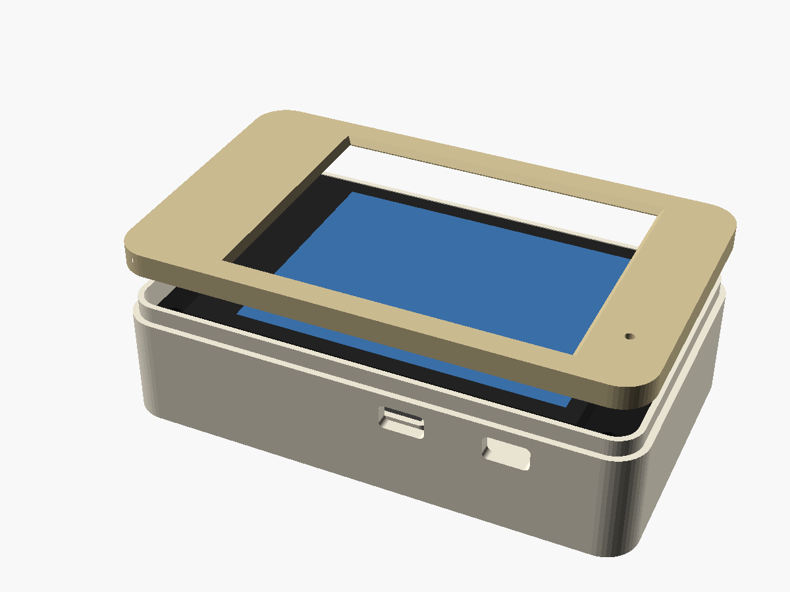
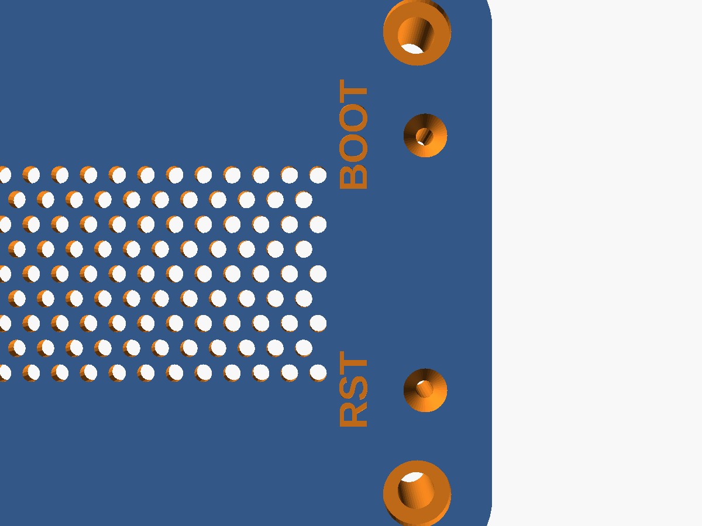

# Case: Freenove ESP32-S3 Display 2.8" (FNK0104A / FNK0104B)

A printed case for the [`freenove-s3` build](../../docs/PINOUT.md). Outside size
is 91.6 × 55 × 24 mm.

| File | What |
|---|---|
| `squachwatch_freenove_s3_28_case.scad` | Parametric source (OpenSCAD 2021+) |
| `squachwatch_freenove_s3_28_print_plate.stl` | Tub and lid side by side as separate pieces, ready to slice |
| `squachwatch_freenove_s3_28_back.stl` | Just the tub with standoffs. Print floor-down, no supports |
| `squachwatch_freenove_s3_28_lid.stl` | Just the lid (front frame). Print face-down, no supports |





The dimensions come from the board's outline drawing, figure 5.1 in
`Datasheet/ES3C28P_ES2N28P_Specification_V1.0.pdf` in
[Freenove's repo](https://github.com/Freenove/Freenove_ESP32_S3_Display). The drawing gives:

- the PCB at 86 × 50 mm, with Ø3.2 holes on a 78 × 42 mm pattern
- the stack above the PCB: glue, LCD, glue and touch glass add up to 4.3 mm
- the parts on the back at up to 4.7 mm tall
- the connector positions

## What it has

- **Fastening:** 4 × M3 × 20 mm pan-head screws. They go in from the back, through the standoffs and the board's corner holes, and thread into bosses on the bezel. That clamps the board, case and bezel together, and all the screw heads end up on the back.
- **Buttons:** RESET and BOOT sit either side of the USB-C (RESET on the right, BOOT on the left, looking at the USB end with the screen up). They face the back of the board, about 10 mm above the floor, so each gets a labelled **paperclip hole** in the floor. A guide tube inside steers the clip onto the switch. BOOT is GPIO0, the firmware's button.
- **Openings:** USB-C on the left end; I2C and IO on the bottom edge; UART and the TF slot (with a finger scoop) on the top edge.
- **Mic:** a hole in the bezel over the front-facing mic.
- **Speaker:** a pocket and grille for the 38 × 27 × 10 mm Freenove speaker. Change `spk_l`, `spk_w`, `spk_d` and `spk_center` if yours is different. The speaker plugs into the PH1.25 SPEAKER header.
- **Battery:** room to the right of the speaker for a LiPo of about 30 × 45 × 10 mm. It plugs into the MX1.25 BAT header; check the polarity against Freenove's diagram.

## Before printing

- `btn_h`: the height of the RESET/BOOT switches off the PCB back, actuator included. I used 2.0 mm. The guide tubes stop 0.6 mm short of the switch, so if a tube touches it, raise this. Only `squachwatch_freenove_s3_28_back.stl` changes.
- `back_clear` is 15 mm: the 10 mm speaker plus the 4.7 mm parts on the PCB back. With no speaker or battery, about 6 is enough. The screw length printed when you render follows it. `io_ports`, `sd_slot`, `mic_hole` and `speaker` each turn their feature off.

## Build

```bash
openscad -D 'part="print"' -o squachwatch_freenove_s3_28_print_plate.stl squachwatch_freenove_s3_28_case.scad
openscad -D 'part="back"'  -o squachwatch_freenove_s3_28_back.stl        squachwatch_freenove_s3_28_case.scad
openscad -D 'part="bezel"' -o squachwatch_freenove_s3_28_lid.stl       squachwatch_freenove_s3_28_case.scad
```

## Assembly

1. Put the speaker face-down in its pocket, and stick the battery down with foam tape if you have one. Plug both in.
2. Lower the board in, screen up, then put the bezel on top.
3. Turn it over and drive the four M3 screws from the back. Stop when it's snug: they cut their own thread in the bezel bosses.

Print in PLA or PETG, with 0.2 mm layers and 3 walls.
